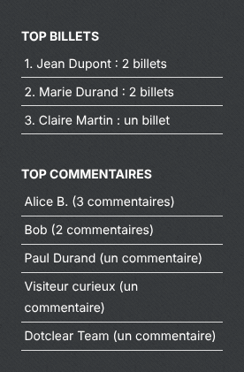
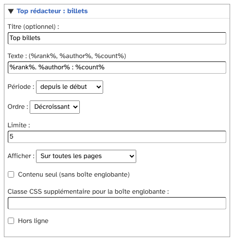
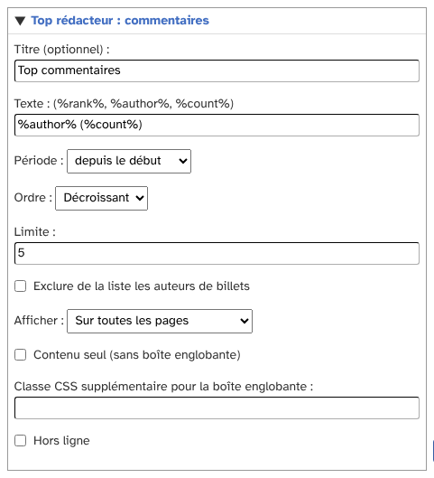
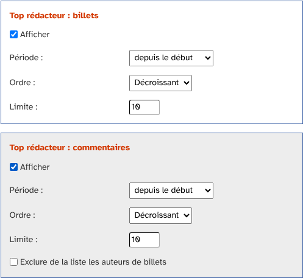
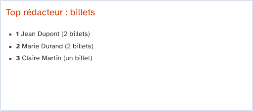
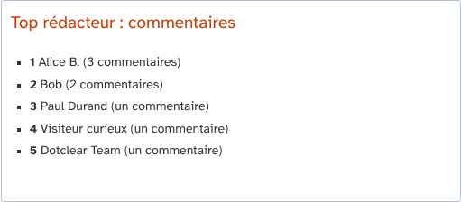

# topWriter : guide d'utilisation

topWriter classe les rédacteurs de billets et les auteurs de commentaires les plus actifs de votre blog. Le classement s'affiche dans la colonne latérale du blog, avec deux widgets, et peut aussi apparaître sur le tableau de bord de l'administration.

Le plugin n'a pas de page d'administration.

## Sommaire

* [Les deux widgets](#les-deux-widgets)
* [Ajouter un widget](#ajouter-un-widget)
* [Régler un widget](#régler-un-widget)
* [Le texte de chaque ligne](#le-texte-de-chaque-ligne)
* [Afficher le classement sur le tableau de bord](#afficher-le-classement-sur-le-tableau-de-bord)
* [Bon à savoir](#bon-à-savoir)

## Les deux widgets

* « Top rédacteur : billets » : les utilisateurs du blog qui ont publié le plus de billets.
* « Top rédacteur : commentaires » : les visiteurs qui ont écrit le plus de commentaires.

## Ajouter un widget

1. Ouvrez « Widgets » dans le menu « Blog ».
2. Dans la liste des widgets disponibles, choisissez « Top rédacteur : billets » ou « Top rédacteur : commentaires ».
3. Choisissez la zone (par exemple « Extra »), puis cliquez sur « Ajouter ».
4. Réglez le widget, puis enregistrez.

## Régler un widget

Cliquez sur le titre du widget pour ouvrir ses réglages.

* « Titre » : le titre au-dessus de la liste. Il est « Top billets » ou « Top commentaires » par défaut.
* « Texte » : la forme de chaque ligne (voir plus bas).
* « Période » : « dernier jour », « dernière semaine », « dernier mois », « dernière année » ou « depuis le début ». Par défaut : « dernière année ».
* « Ordre » : « Décroissant » (les plus actifs d'abord) ou « Croissant ».
* « Limite » : le nombre de lignes. Par défaut : 10.
* « Afficher », « Contenu seul », « Classe CSS » et « Hors ligne » : les réglages habituels des widgets.

Le widget des commentaires a un réglage de plus : « Exclure de la liste les auteurs de billets ». Cochez-le pour que les rédacteurs du blog n'apparaissent pas dans le classement des commentaires.

Un widget qui n'a rien à afficher (aucun billet ou commentaire sur la période) disparaît du blog.

## Le texte de chaque ligne

Le champ « Texte » accepte trois mots-clés, remplacés à l'affichage :

* `%rank%` : la place (1, 2, 3…) ;
* `%author%` : le nom ;
* `%count%` : le nombre, avec son nom : « 3 billets », « un commentaire ».

Le texte par défaut est `%author% (%count%)`. Avec `%rank%. %author% : %count%`, vous obtenez « 1. Marie Durand : 3 billets ».

Le nom est un lien quand l'auteur a une adresse de site : pour un rédacteur, sa page d'auteur si le plugin authorMode est actif, sinon l'adresse de son profil ; pour un visiteur, le site indiqué dans son commentaire.

## Afficher le classement sur le tableau de bord

Chaque utilisateur peut aussi voir ces classements sur son tableau de bord.

1. Ouvrez « Mes préférences » (en haut à droite).
2. Allez dans l'onglet « Mes favoris ».
3. Repérez les deux cadres « Top rédacteur : billets » et « Top rédacteur : commentaires ».
4. Cochez « Afficher », choisissez la période, l'ordre et la limite (de 1 à 20). Pour les commentaires, vous pouvez aussi exclure les auteurs de billets.
5. Enregistrez.

Deux encadrés apparaissent alors sur le tableau de bord.

Par défaut, rien ne s'affiche sur le tableau de bord, la période est « dernier mois » et les plus actifs sont en premier. Les noms n'y sont pas des liens.

## Bon à savoir

* Seuls les billets publiés et les commentaires publiés sont comptés. Les comptes d'utilisateurs désactivés ne sont pas comptés.
* Les commentaires sont regroupés par adresse e-mail, sans tenir compte des majuscules : une même personne qui écrit avec deux noms apparaît une seule fois, sous le nom de son commentaire le plus récent. Sans adresse e-mail, ils sont regroupés par nom.
* À nombre égal, le plus récemment actif passe en premier.
* Les périodes suivent le calendrier : « dernier mois » remonte au même jour du mois précédent, « dernière année » au même jour de l'année précédente.
* Les widgets ne comptent que le blog courant.
